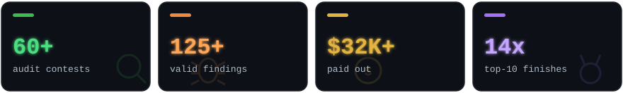
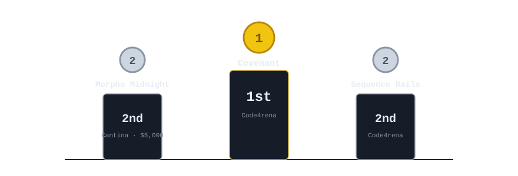
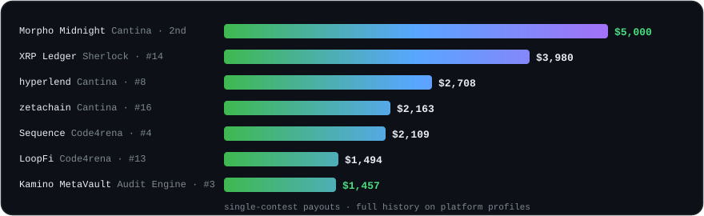
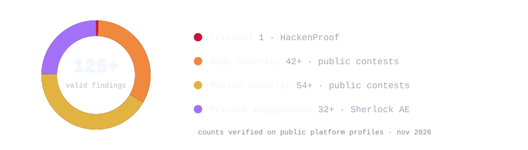
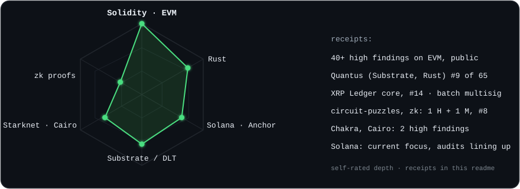
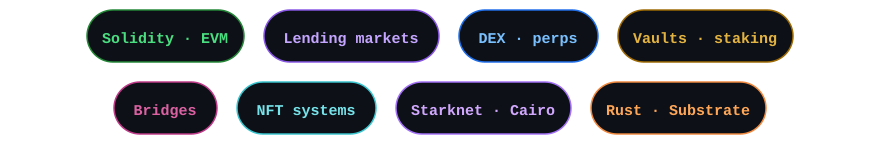
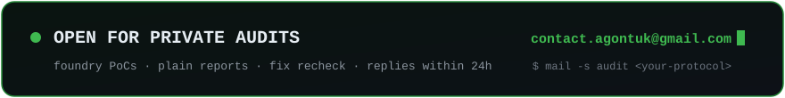

<!-- agontuk · smart contract auditor portfolio · numbers pulled from public profiles, nov 2026 -->

  

---

## Profile Summary

Independent **smart contract security researcher**, aka **Agontuk** (Neeloy).

Primary focus: **EVM DeFi security**. Lending markets, DEXes, perps, vaults, staking.

Secondary experience: **Solana (Anchor)**, **Rust / Substrate**, **Starknet (Cairo)**, **XRPL core**, **zk proofs**.

X (Twitter): **[@4gontuk](https://x.com/4gontuk)** · Telegram: **[@Ag0ntuk](https://t.me/Ag0ntuk)** · Discord: `@4gontuk` · Email: **[contact.agontuk@gmail.com](mailto:contact.agontuk@gmail.com)**

Profiles: **[Code4rena](https://code4rena.com/@Agontuk)** · **[Sherlock](https://audits.sherlock.xyz/watson/neeloy)** · **[Cantina](https://cantina.xyz/u/Agontuk1)** · **[Immunefi](https://immunefi.com/audit-competition/audit-comp-quantus/leaderboard/)**

Record: **55+ public contests** · **6 private engagements** · **125+ valid findings** (1 critical · 40+ high) · **$32K+ paid** · 3 podiums · 14 top-10s

  

---

## Public Engagements

| Project | Protocol Type | Platform | Result |
|---|---|---|---|
| **[Covenant](https://code4rena.com/audits/2025-10-covenant/submissions/S-505)** | On-chain wealth management | Code4rena | **1 🏅** |
| **[Morpho Midnight](https://cantina.xyz/competitions/4679e0fa-85f7-4ea5-8827-ee6c70bdee6b/leaderboard)** | Fixed-rate lending | Cantina | **2 🥈** |
| **[Sequence: Transaction Rails](https://code4rena.com/reports/2025-11-sequence-transaction-rails)** | Smart wallet transaction rails | Code4rena | **2 🥈** |
| **[Sequence](https://code4rena.com/reports/2025-10-sequence)** | Smart wallet platform | Code4rena | 4 |
| Velar Artha | Perpetuals DEX | Sherlock | 6 |
| primev Validator Registry | Validator & registry infrastructure | Cantina | 6 |
| **[Pump Science](https://code4rena.com/reports/2025-01-pump-science)** | Memecoin launchpad | Code4rena | 6 |
| **[Reserve Core](https://code4rena.com/reports/2024-07-reserve-core)** | Stablecoin protocol | Code4rena | 7 |
| circuit-puzzles | zk circuits | Cantina | 8 |
| hyperlend | Lending (HyperEVM) | Cantina | 8 |
| **[Axelar Network](https://code4rena.com/reports/2024-08-axelar-network)** | Cross-chain bridge | Code4rena | 9 |
| Rujira | DeFi app layer (THORChain) | Code4rena | 9 |
| **[Quantus](https://immunefi.com/audit-competition/audit-comp-quantus/leaderboard/)** | Post-quantum L1 (Rust · Substrate) | Immunefi | **9 / 65** |
| Fluid DEX v2 | Lending + DEX liquidity | Sherlock | 10 |
| Index Fun | Order book | Sherlock | 10 |

40+ more contests with top-25 finishes and payouts. Full history on the profiles above. Also contest on CodeHawks, Dual Guard and SpecSiege.

  

Covenant's official report names my writeup as [the judge's top score](https://code4rena.com/audits/2025-10-covenant/submissions/S-505).

Biggest single prizes:

  

---

## Private Engagements

4 private engagements on **Sherlock Audit Engine**. Not contests. No crowds. The client sets scope and a pot, I go in deep, findings get judged after close, results publish.

| Project | Date | Firm | Protocol Type | Report |
|---|---|---|---|---|
| **Kamino MetaVault** | November 2026 | Sherlock Audit Engine | Lending (Solana) | Published · **#3 of field** |
| Uniswap | October 2026 | Sherlock Audit Engine | AMM / DEX | Results public |
| Aero | October 2026 | Sherlock Audit Engine | DEX (Base) | Results public |
| Polygon Heimdall V2 | July 2026 | Sherlock Audit Engine | L1 client (Polygon) | Results public |
| Undisclosed ×2 | 2025 · 2026 | Independent | - | Private (NDA) |

Kamino MetaVault: **10 accepted findings** (2 High · 2 Medium · 6 Low), 71.4% precision, **$1,456.80** paid.

Across all four: **30+ accepted findings**, **$4.2K** paid. Reports stay sealed until clients publish them. The names are the receipts.

---

## Selected Findings

1 critical on a HackenProof bounty sits on top of these. Click a protocol name for proof.

Code4rena rows go straight to the exact finding in the official report, my name on it. Sherlock findings live on [my Sherlock profile](https://audits.sherlock.xyz/watson/neeloy) under the same titles.

  

| # | Severity | Protocol | Platform | Bug type | What happens |
|---|---|---|---|---|---|
| 01 |  | **[XRP Ledger](https://audits.sherlock.xyz/watson/neeloy)** | Sherlock | Access control | Batch multisignatures can be rebound to another account with the same signer list. An attacker spends XRP without owning it. XRPL later rebuilt the whole Batch amendment as V1.1 over this bug class |
| 02 |  | **[Fluid DEX v2](https://audits.sherlock.xyz/watson/neeloy)** | Sherlock | Liquidity | Attacker drains pooled liquidity from honest suppliers |
| 03 |  | **[Ammplify](https://audits.sherlock.xyz/watson/neeloy)** | Sherlock | Callback validation | Arbitrary token drain from Diamond through an unverified Uniswap V3 mint callback |
| 04 |  | **[Panoptic](https://code4rena.com/reports/2025-12-panoptic-next-core#h-01-builderwallet-init-is-unprotectedre-initializable-enabling-takeover-and-theft-of-builder-fees)** | Code4rena | Initialization | Unprotected, re-initializable `BuilderWallet.init()`. Takeover and theft of builder fees |
| 05 |  | **[Olas](https://code4rena.com/audits/2026-01-olas/submissions/S-902)** | Code4rena | Reentrancy | Cross-service reentrancy in `StakingBase._withdraw`. Protocol goes insolvent |
| 06 |  | **[Velocimeter](https://solodit.cyfrin.io/issues/h-2-votingescrow-max_delegates-value-can-lead-to-dos-on-certain-evm-compatible-chains-sherlock-velocimeter-git)** | Sherlock | Vote escrow | Delegation DoS at `MAX_DELEGATES` ([on Solodit](https://solodit.cyfrin.io/issues/h-2-votingescrow-max_delegates-value-can-lead-to-dos-on-certain-evm-compatible-chains-sherlock-velocimeter-git)) · rewards locked forever via `killGaugeTotally` · stale supply checkpoint pays users wrong rewards |
| 07 |  | **[Chakra](https://code4rena.com/reports/2024-08-chakra#h-07-anyone-can-manipulate-user-nonce-nonce_manager-in-settlement-contract)** | Code4rena | Cross chain | User nonces can be manipulated by anyone, [H-07](https://code4rena.com/reports/2024-08-chakra#h-07-anyone-can-manipulate-user-nonce-nonce_manager-in-settlement-contract) · processed Starknet messages replayable, [H-02](https://code4rena.com/reports/2024-08-chakra#h-02-in-starknet-already-processed-messages-can-be-re-submitted-and-by-anyone) |
| 08 |  | **[LoopFi](https://code4rena.com/reports/2024-07-loopfi)** | Code4rena | Accounting | `AuraVault::claim` skips fee deduction from reward amounts. DoS or rewards silently lost |

---

## Stack & Learning

  

- **Solana**: Anchor, account model, CPI traps. Current focus. First Solana audits lining up.
- **Blockchain / DLT**: Substrate runtime and XRPL core. Chain-level review, not just contracts. Quantus #9 of 65. Batch multisig find on XRP Ledger, #14.
- **zk proofs**: circuit-puzzles on Cantina: 1 High, 1 Medium, #8 of field. Quantus zk components too. Little but growing fast.
- **Starknet**: Cairo. Chakra: 2 high findings.

Learning right now: Solana security deep dive, zk proof systems.

  

---

## How I Work

- I read all the code. Then I try to steal from it.
- Every bug ships with a working proof of concept.
- You get a plain report. What to fix and why. No filler.
- When you ship fixes, I recheck them.
- Full confidentiality. Private work stays private; the public record stays verifiable.

---

## Contact

| | |
|---|---|
|  |    discord → `@4gontuk` |

Open for private audits. Want me to break your code before someone else does?

    
  numbers pulled from public profiles · nov 2026

