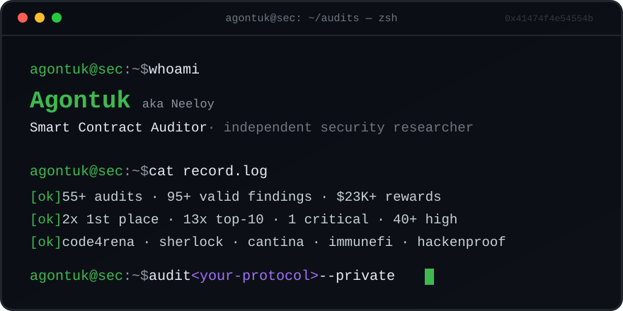

<!-- Agontuk — smart contract auditor portfolio. Stats verified against platform profiles, Nov 2026. -->

<div align="center">
  
</div>

<div align="center">
  <a href="https://code4rena.com/@Agontuk"></a>
  <a href="https://audits.sherlock.xyz/watson/neeloy"></a>
  <a href="https://cantina.xyz/u/Agontuk1"></a>
  <a href="https://immunefi.com/audit-competition/audit-comp-quantus/leaderboard/"></a>
  <a href="mailto:contact.agontuk@gmail.com"></a>
</div>

---

## `$ whoami`

Independent smart-contract security researcher going by **Agontuk**. Since 2024 I've hacked through **55+ audit competitions** across Code4rena, Sherlock, Cantina, Immunefi and HackenProof — landing **95+ validated findings** (40+ high-severity), **13 top-10 finishes**, and a couple of gold podiums along the way.

My turf: EVM DeFi (lending markets, DEXes, perps, vaults, restaking), cross-chain bridges & messaging, NFT/lottery systems — and non-EVM targets like Starknet and Rust/Substrate L1s.

> **Currently accepting private audits** → [contact.agontuk@gmail.com](mailto:contact.agontuk@gmail.com)

---

## `$ ./stats --all-time`

```bash
$ ./agontuk --stats --all-time
├─ audit competitions ......... 55+
├─ valid findings ............. 95+   (1 critical · 40+ high · 50+ medium)
├─ verified rewards ........... $23K+
├─ podiums .................... 2x 1st place · 13x top-10 · 35x top-25
├─ protocols helped secure .... 50+
├─ private engagements ........ 2 (NDA)
└─ active since ............... 2024
```

<p>
  
  
  
  
  
</p>

*Every number below is pulled from public, verifiable platform profiles (synced Nov 2026).*

---

## `$ cat platforms.log`

| Platform | Handle | Record | Highlights |
|---|---|---|---|
| [**Code4rena**](https://code4rena.com/@Agontuk) | `Agontuk` | **22 High · 38 Medium** | 🥇 1st — Covenant · 🥈 2nd — Sequence Rails · **#96 this year** · 24 protocols helped secure |
| [**Sherlock**](https://audits.sherlock.xyz/watson/neeloy) | `neeloy` / `4gontuk` | **2× 1st place** · 13× Top 10 · 35× Top 25 | 52 payouts · #398 all-time |
| [**Cantina**](https://cantina.xyz/u/Agontuk1) | `Agontuk1` / `4gontuk` | **6 High · 4 Medium** · 11 competitions | Cantina Fellowship '24 · primev **#6** · circuit-puzzles **#8** · hyperlend **#8** |
| [**Immunefi**](https://immunefi.com/audit-competition/audit-comp-quantus/leaderboard/) | `n3310y` | **4 valid Highs** | **#9 / 65** — Quantus: post-quantum Rust L1 (Substrate · 64.8k LoC) |
| **HackenProof** | — | **1 Critical** | public bounty program |

---

## `$ grep -r "critical\|high" findings/`

Public, verified high-severity findings — full reports via the linked platform profiles:

| # | Severity | Protocol | Platform | Bug class | Impact |
|---|---|---|---|---|---|
| 01 |  | **XRP Ledger** | Sherlock | Access control | Batch multisignatures can be rebound to another account with the same signer list → unauthorized XRP spend |
| 02 |  | **Fluid DEX v2** | Sherlock | Liquidity | Attacker drains pooled liquidity from honest suppliers |
| 03 |  | **Ammplify** | Sherlock | Callback validation | Arbitrary token drain from Diamond via unverified Uniswap V3 mint callback |
| 04 |  | **Panoptic** | Code4rena | Initialization | Unprotected, re-initializable `BuilderWallet.init()` → wallet takeover and theft of builder fees |
| 05 |  | **Olas** | Code4rena | Reentrancy | Cross-service reentrancy in `StakingBase._withdraw` → insolvency |
| 06 |  | **Winnables Raffles** | Sherlock | ETH accounting | Incorrect ETH locking in `refundPlayers` → permanent fund lockup |
| 07 |  | **Velocimeter** | Sherlock | Vote-escrow | Delegation DoS at `MAX_DELEGATES` · rewards permanently locked via `killGaugeTotally` · stale total-supply checkpoint → wrong reward payouts |
| 08 |  | **Chakra** | Code4rena | Cross-chain | Anyone can manipulate user nonces in the settlement contract · processed Starknet messages can be re-submitted by anyone |

---

## `$ history | grep podium`

- 🥇 **1st place — Covenant** (Code4rena)
- 🥈 **2nd place — Sequence: Transaction Rails** (Code4rena)
- **4th** — Sequence · **6th** — Pump Science · **9th** — Rujira (4 High + 4 Medium in a single contest) — all Code4rena
- **13× top-10 finishes** across platforms: `#4` Sequence · `#6` Velar Artha, primev, Pump Science · `#7` Reserve Core · `#8` circuit-puzzles, hyperlend · `#9` Axelar Network, Rujira, Quantus · `#10` Fluid DEX v2, Index Fun…
- **35× top-25 finishes** on Sherlock alone

---

<details>
<summary><b>$ cat full_battle_record.log</b> <i>(all 53 public competitions — click to expand)</i></summary>

| Date | Contest | Platform | Place | Findings | Payout |
|---|---|---|---|---|---|
| Jun '26 | DRE App — dreUSD | Sherlock | #65 | — | $27.48 |
| Apr '26 | **XRP Ledger** | Sherlock | **#14** | 1 H / 5 M | **$3,979.95** |
| Apr '26 | Clear Macro by Superfluid | Sherlock | #57 | — | $15.79 |
| Mar '26 | Chainlink Payment Abstraction V2 | Code4rena | #11 | 1 M | — |
| Feb '26 | **Injective Peggy Bridge** | Code4rena | #16 | 1 H / 2 M | $44.12 |
| Feb '26 | **Olas** | Code4rena | #54 | 1 H | $1.21 |
| Feb '26 | **Fluid DEX v2** | Sherlock | **#10** | 1 H / 1 M | $194.51 |
| Feb '26 | OpenCover Insured Vaults | Sherlock | #54 | — | $22.47 |
| Feb '26 | Hotstuff | Sherlock | #39 | — | $29.70 |
| Feb '26 | Flying Tulip | Sherlock | #84 | — | $117.32 |
| Dec '25 | **Panoptic: Next Core** | Code4rena | #15 | 1 H / 4 M | $527.31 |
| Dec '25 | **Rujira** | Code4rena | **#9** | 4 H / 4 M | $703.12 |
| Dec '25 | Monolith Stablecoin Factory | Sherlock | #11 | 4 M | $208.42 |
| Nov '25 | Swafe | Code4rena | #23 | 2 M | $15.58 |
| Nov '25 | **Sequence: Transaction Rails** | Code4rena | 🥈 **2nd** | — | $189.47 |
| Nov '25 | Megapot | Code4rena | #25 | 2 M | $0.13 |
| Oct '25 | **Covenant** | Code4rena | 🥇 **1st** | — | $757.89 |
| Oct '25 | Index Fun Order Book | Sherlock | **#10** | 1 M | $70.67 |
| Oct '25 | **Sequence** | Code4rena | **#4** | 2 M | **$2,109.39** |
| Sep '25 | **Ammplify** | Sherlock | #16 | 3 H / 4 M | $377.46 |
| Aug '25 | Fluid | Code4rena | #16 | — | $764.94 |
| Aug '25 | kuru-contracts | Cantina | #54 | 1 H | $313.61 |
| May '25 | primev-validator-registry | Cantina | **#6** | 1 H | $0.18 |
| May '25 | stability-contracts | Cantina | #26 | 1 H | $77.49 |
| May '25 | circuit-puzzles | Cantina | **#8** | 1 H / 1 M | **$1,139.23** |
| Apr '25 | mezo-monorepo | Cantina | #17 | 1 H | $977.49 |
| Feb '25 | defi-app-contracts | Cantina | #26 | 1 H | $11.53 |
| Jan '25 | daao-contracts | Cantina | #13 | 4 H / 1 M | $296.83 |
| Jan '25 | dahlia-protocol | Cantina | #14 | 1 M | $1,137.14 |
| Jan '25 | Liquid Ron | Code4rena | #11 | 1 M | — |
| Jan '25 | Pump Science | Code4rena | **#6** | 1 M | $417.31 |
| Dec '24 | SecondSwap | Code4rena | #45 | 1 H / 2 M | $6.98 |
| Dec '24 | Oku — New Order Types | Sherlock | #65 | 1 M | $0.01 |
| Dec '24 | **Lambo.win** | Code4rena | #16 | 2 H / 1 M | $196.51 |
| Nov '24 | Concrete | Code4rena | #55 | — | $141.88 |
| Nov '24 | hyperlend | Cantina | **#8** | 1 M | **$2,708.38** |
| Sep '24 | symbioticfi-core | Cantina | #22 | 1 M | $211.51 |
| Aug '24 | Velar Artha PerpDEX | Sherlock | **#6** | 1 M | $873.14 |
| Aug '24 | **Chakra** | Code4rena | #54 | 2 H | $2.03 |
| Aug '24 | **Cork Protocol** | Sherlock | #15 | 1 H / 1 M | $31.50 |
| Aug '24 | Rumpel Point Tokenization | Sherlock | #14 | — | $88.38 |
| Aug '24 | Superposition | Code4rena | #32 | 1 M | $1.26 |
| Aug '24 | **Phi** | Code4rena | #47 | 1 H | $9.15 |
| Aug '24 | **zetachain-protocol** | Cantina | #16 | 2 H | **$2,162.62** |
| Aug '24 | **Winnables Raffles** | Sherlock | #37 | 1 H | $1.80 |
| Aug '24 | Sentiment V2 | Sherlock | #42 | 2 M | $12.96 |
| Aug '24 | **Axelar Network** | Code4rena | **#9** | — | — |
| Jul '24 | **Basin** | Code4rena | #11 | 1 H | $8.44 |
| Jul '24 | **Reserve Core** | Code4rena | **#7** | — | — |
| Jul '24 | **TraitForge** | Code4rena | #16 | 1 H / 2 M | $284.23 |
| Jul '24 | **LoopFi** | Code4rena | #13 | 1 H / 3 M | **$1,493.94** |
| Jul '24 | **Velocimeter** | Sherlock | #20 | 3 H / 2 M | $439.87 |

*2 additional private engagements completed under NDA. Payouts as published on the aggregated Sherlock profile (incl. Code4rena & Cantina contests).*

</details>

---

## `$ ./engagement --private`

- **2 private audits completed** (NDA) — contest-grade intensity, report-grade output.
- Manual, first-principles review — no checklist noise: protocol logic, economic incentives, attack paths, edge cases.
- Severity-rated findings with reproducible **Foundry PoCs** and clear remediation guidance.
- Full confidentiality: private work stays private; public record stays verifiable.

**Scope:** Solidity / EVM · DeFi (lending, AMM/Dex, perps, vaults, staking, restaking) · bridges & cross-chain messaging · NFT systems · Starknet (Cairo) · Rust / Substrate L1s.

**Open for new engagements:** [contact.agontuk@gmail.com](mailto:contact.agontuk@gmail.com)

---

## `$ contact --list`

| | |
|---|---|
|  | <a href="mailto:contact.agontuk@gmail.com"></a><br/><a href="https://x.com/4gontuk"></a><br/><a href="https://t.me/Ag0ntuk"></a><br/>discord → `@4gontuk` |

---

<div align="center">
  <br/><br/>
  <sub>stats synced &amp; cross-verified against platform profiles · nov 2026</sub>
</div>
